# Digital Testing & Assessment Platform

A web-based assessment management system built with **Python and Flask**, designed to make online testing, assessment management, automated evaluation, and personalized learning recommendations easier.

<p align="center">
  <strong>Online Testing • Role-Based Access • Automated Evaluation • Adaptive Recommendations</strong>
</p>

## About the Project

The Digital Testing & Assessment Platform is a full-stack web application that provides a centralized environment for creating, managing, and attempting online assessments.

The platform supports three main user roles: administrators, test creators, and participants. It includes test creation, question management, timed assessments, result calculation, and topic-based learning recommendations.

This project was developed as a Computer Science portfolio project to demonstrate practical full-stack development skills.

## Features

### User Management
- User registration and login.
- Role-based access control.
- Separate dashboards for administrators, creators, and participants.

### Test Management
- Create, edit, and delete assessments.
- Organize tests by topic and difficulty.
- Configure assessment time limits.
- Upload tests using JSON files.
- Support multiple-choice and open-ended questions.

### Online Assessment
- Interactive test-taking interface.
- Timed assessments.
- Question navigation and answer submission.
- Automatic evaluation and score calculation.

### Results and Learning Support
- Assessment result summaries.
- Topic-based performance feedback.
- Identification of weaker topics.
- Adaptive learning recommendations.
- Suggested learning resources and practice questions.

### Administration
- Dedicated administrator dashboard.
- User and application data management.

## Technology Stack

| Category | Technologies |
|---|---|
| Backend | Python, Flask |
| Frontend | HTML5, CSS3, JavaScript |
| UI Framework | Bootstrap |
| Database | SQLite (local), PostgreSQL (production configuration) |
| ORM | Flask-SQLAlchemy, SQLAlchemy |
| Database Migrations | Flask-Migrate, Alembic |
| Version Control | Git, GitHub |

## Application Screenshots

### 1. Homepage

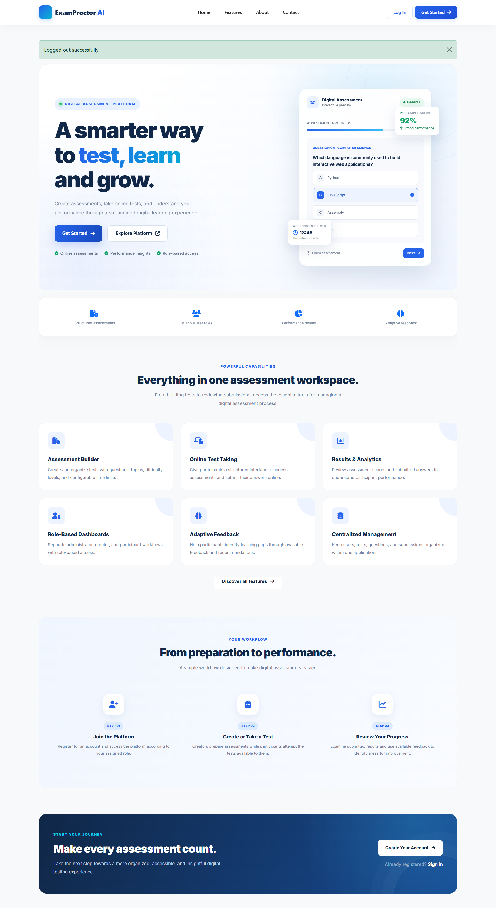

### 2. User Authentication

| Login | Registration |
|---|---|
| 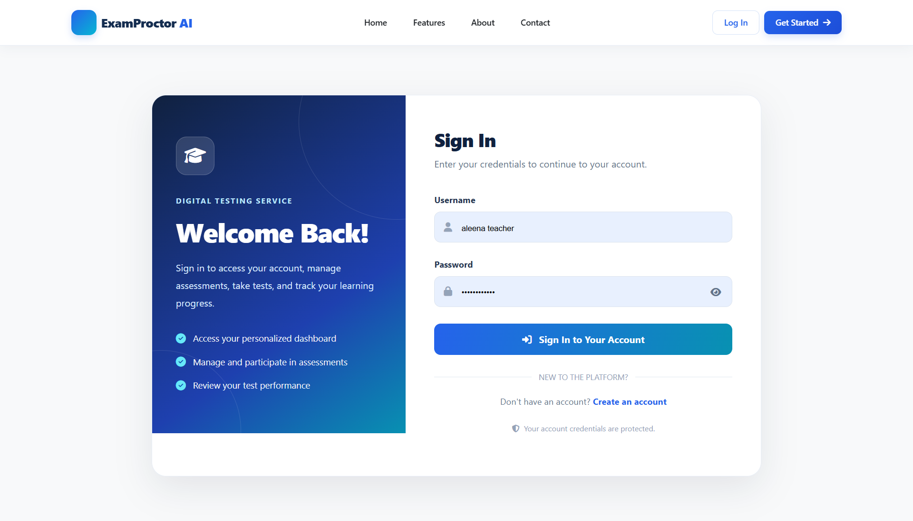 | 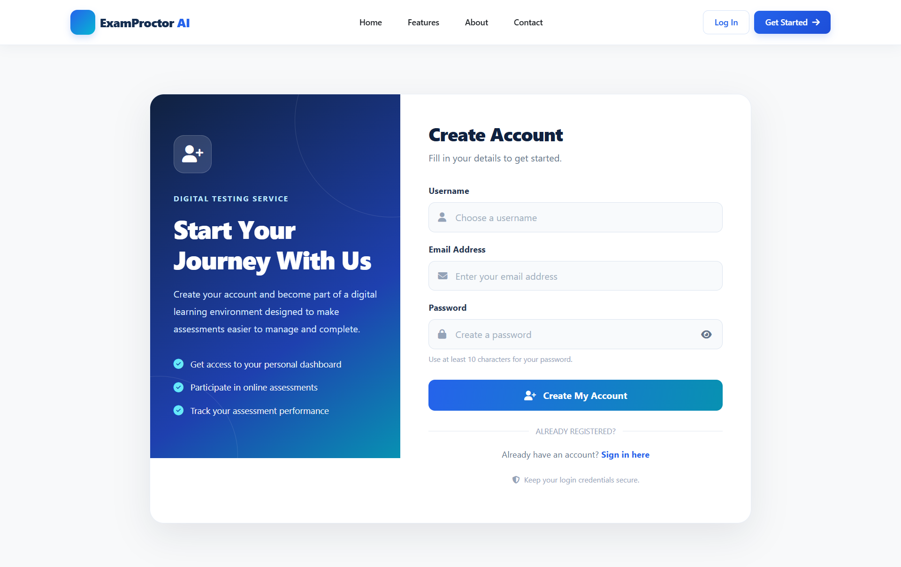 |

### 3. Main Pages

| About | Features | Contact |
|---|---|---|
| 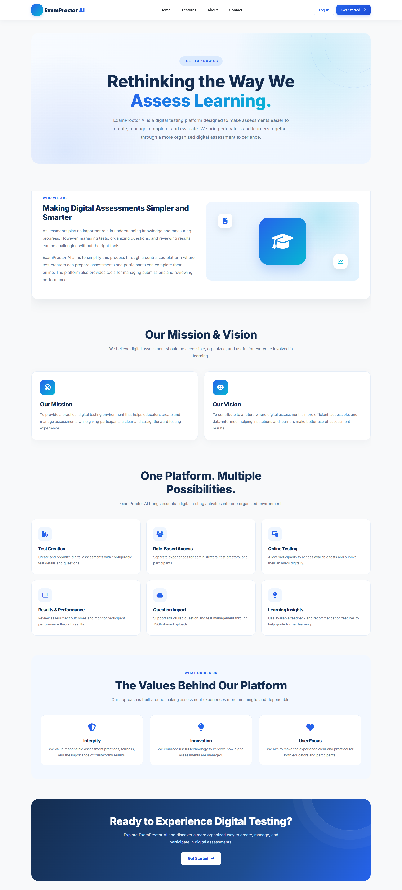 | 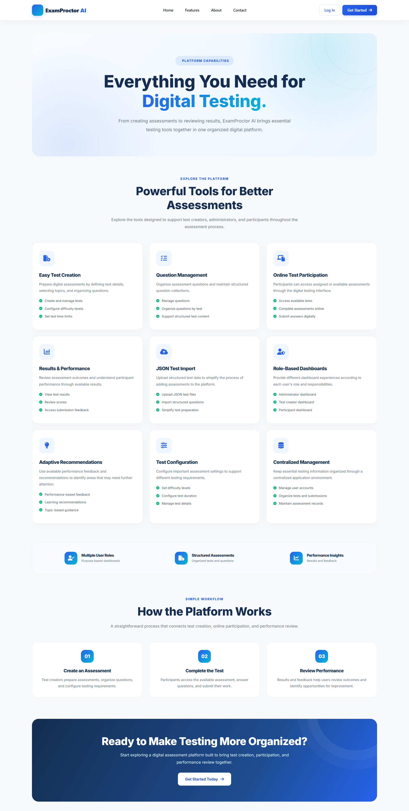 | 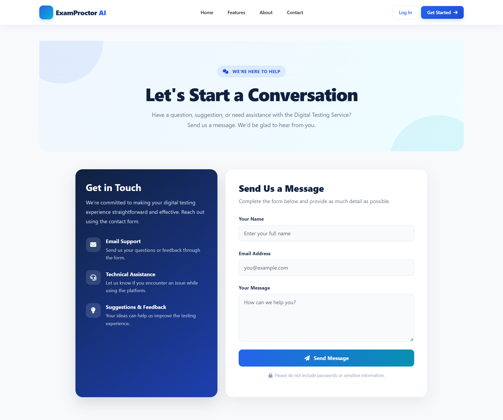 |

### 4. User Dashboards

**Administrator Dashboard**

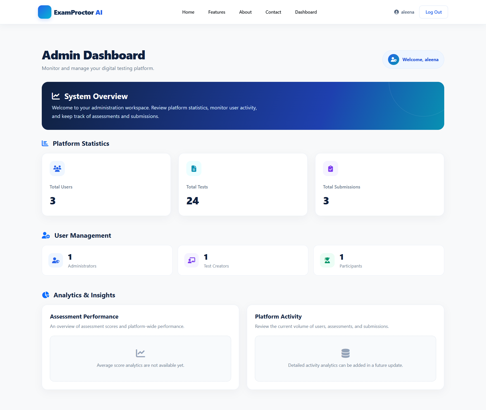

**Test Creator Dashboard**

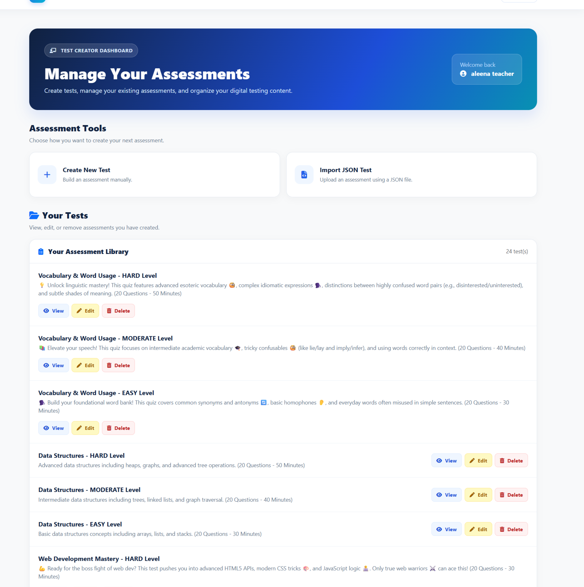

**Participant Dashboard**

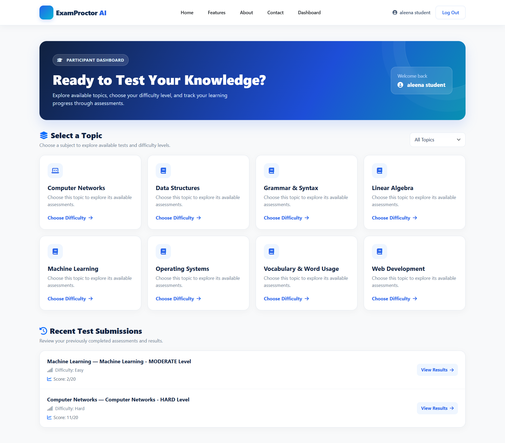

### 5. Test Management

**Test Creation**

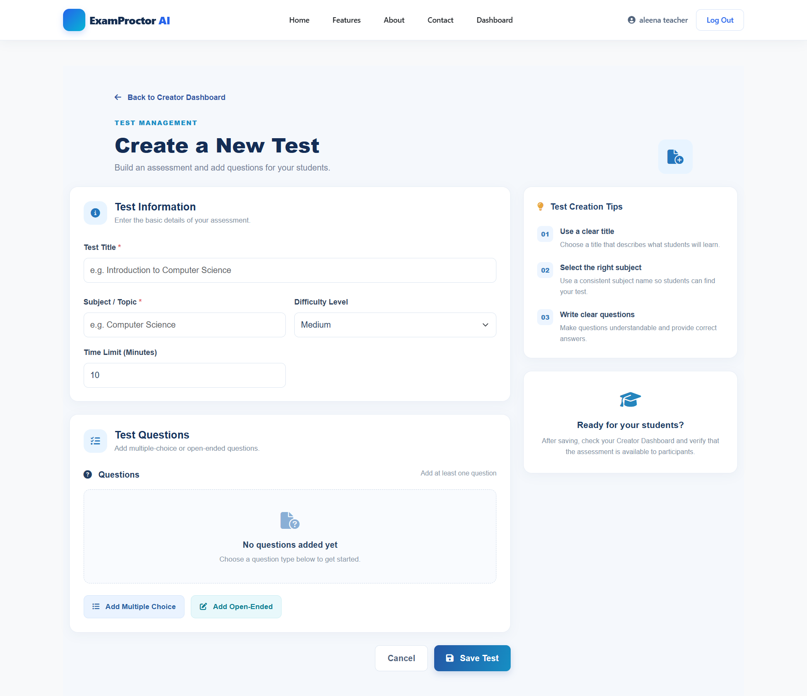

**Test Levels**

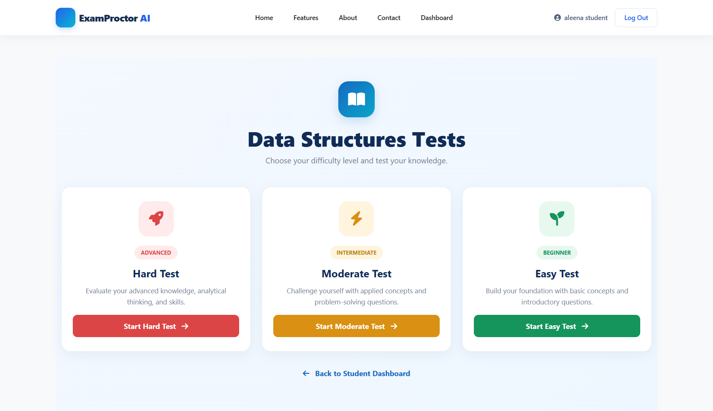

### 6. Online Assessment

**Test Attempt**

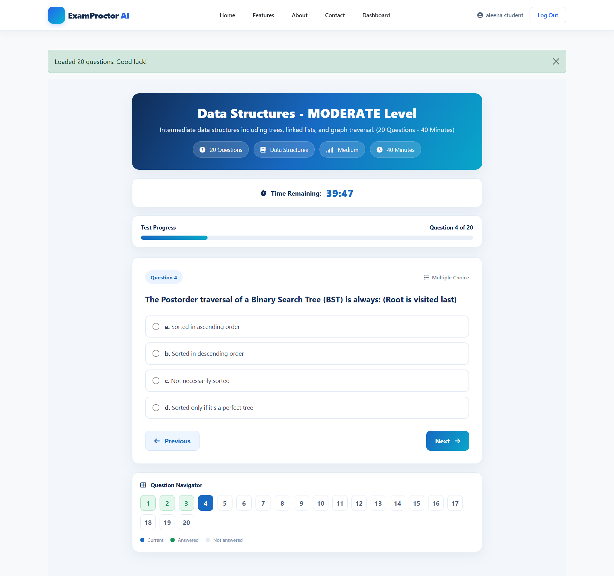

**Test Submission**

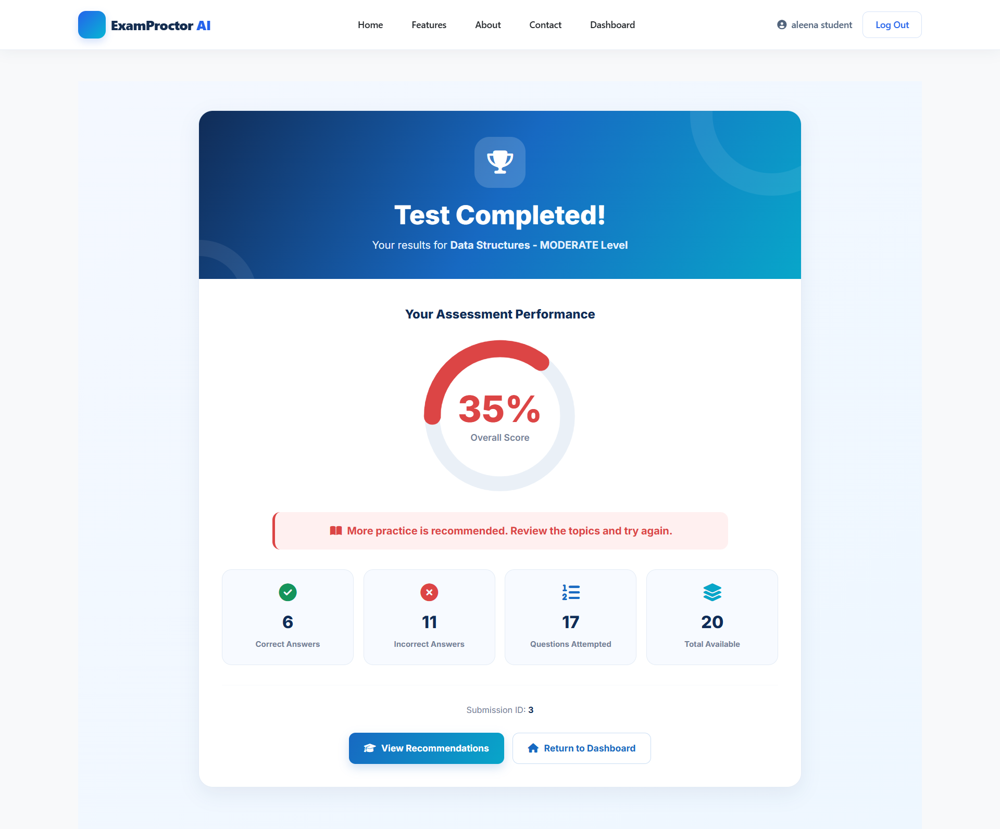

### 7. Results and Recommendations

**Adaptive Recommendations**

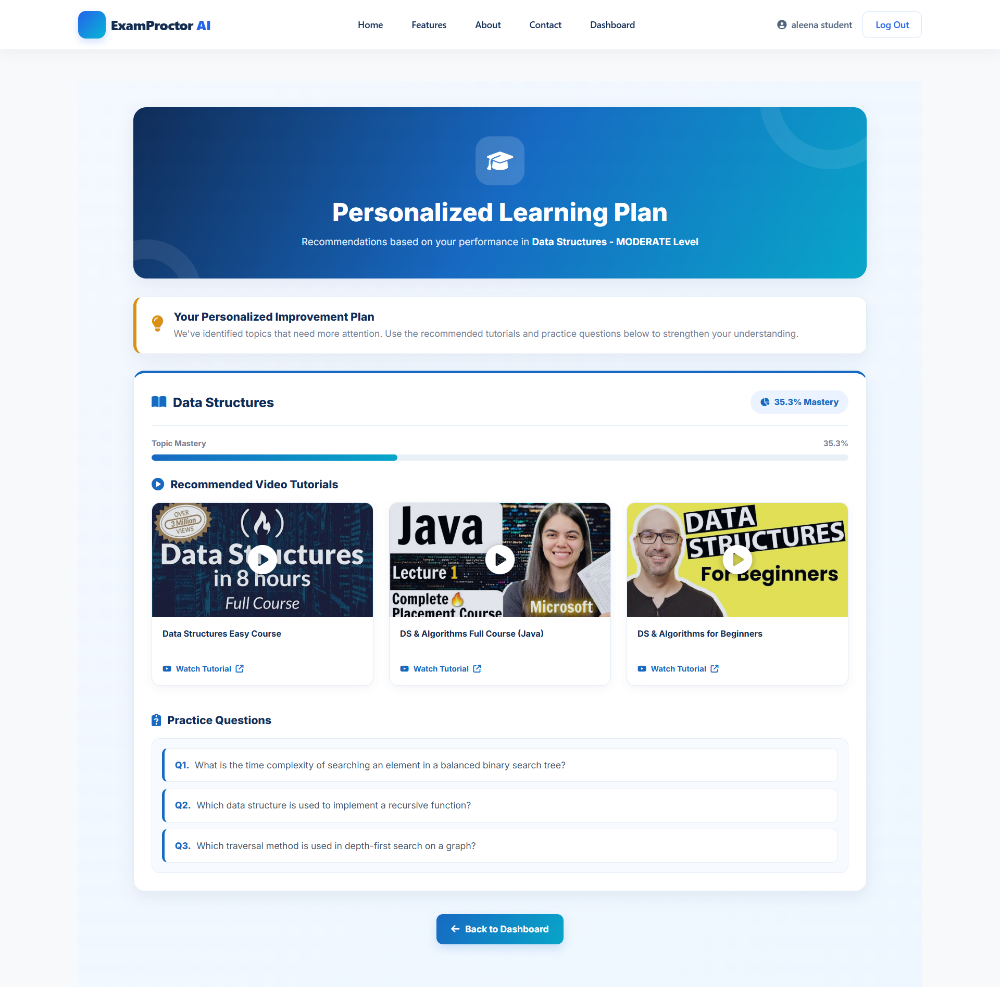

## Project Structure

```text
Digital-Testing-Service/
│
├── app.py
├── requirements.txt
├── .gitignore
├── README.md
│
├── data/
├── migrations/
├── templates/
├── static/
│
└── screenshots/
    ├── about.png
    ├── admin-dashboard.png
    ├── contact.png
    ├── creator-dashboard.png
    ├── features.png
    ├── homepage.png
    ├── login.png
    ├── register.png
    ├── student-dashboard.png
    ├── test-attempt.png
    ├── test-creation.png
    ├── test-levels.png
    ├── test-submission.png
    └── view-recommendation.png
```

## Installation and Local Setup

Follow these steps to run the application locally.

### 1. Clone the repository

```bash
git clone https://github.com/aleena-azam510/Digital-Testing-Service.git
```

### 2. Navigate to the project directory

```bash
cd Digital-Testing-Service
```

### 3. Create a virtual environment

```bash
python -m venv venv
```

### 4. Activate the virtual environment

**Windows:**

```bash
venv\Scripts\activate
```

### 5. Install dependencies

```bash
python -m pip install -r requirements.txt
```

### 6. Configure environment variables

Create a `.env` file in the project root and configure the development secret key and any other required environment variables.

Do not commit this file to GitHub.

### 7. Apply database migrations

```bash
flask --app app db upgrade
```

### 8. Run the application

```bash
flask --app app run --debug
```

Open your browser and visit:

`http://127.0.0.1:5000`

## Future Enhancements

- More advanced assessment analytics.
- Additional question types.
- Enhanced adaptive learning algorithms.
- Improved assessment security.
- Production deployment and cloud hosting.

## Author

**Aleena Azam**

Computer Science Graduate

GitHub: [@aleena-azam510](https://github.com/aleena-azam510)

## Project Repository

[Digital Testing & Assessment Platform — GitHub](https://github.com/aleena-azam510/Digital-Testing-Service)

---

*Developed as a full-stack web application and portfolio project.*
